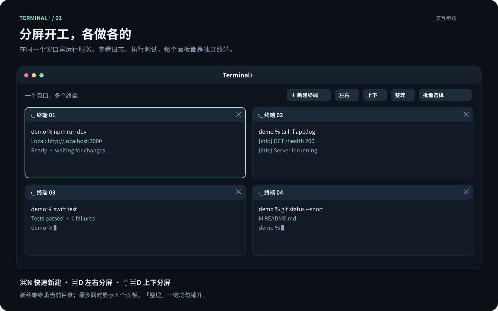
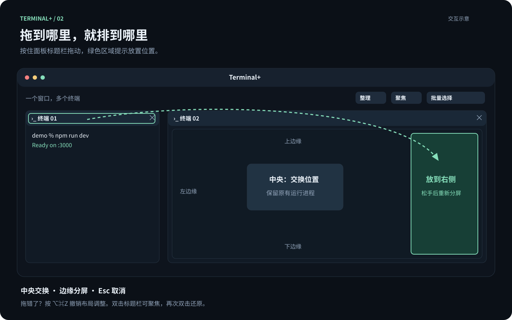
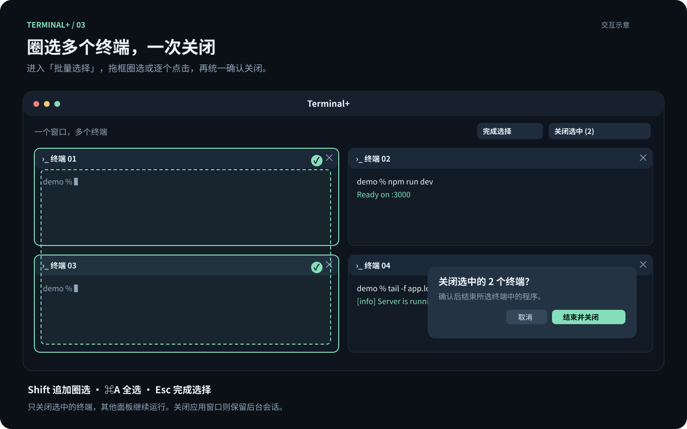

# Terminal+

简单的原生 macOS 分屏终端。打开即是 zsh，点按钮左右或上下分屏，运行什么命令由你决定。

不绑定 Codex、Claude 或项目，不要求 Git，不自动创建 worktree。不需要选择工具或创建工作区。

## 看图上手

以下为交互示意图，终端命令和输出为演示内容。

### 一个窗口，同时处理多件事

运行服务、查看日志、执行测试，各用一个独立终端。点「新建终端」自动选择分屏位置，也可以手动左右或上下分屏。



### 拖动标题栏，调整布局

拖到另一面板中央交换位置，拖到边缘放在它的左、右、上、下方。松手前有绿色落点预览，按 `⌥⌘Z` 可以撤销布局调整。



### 圈选多个终端，统一关闭

点「批量选择」，拖框圈选或逐个点击；`Shift` 追加选择，`⌘A` 全选。点「关闭选中」后统一确认，只结束选中终端中的程序。



## 下载与安装

从 [GitHub Releases](https://github.com/pilotlee17/terminal-plus/releases/latest) 下载 `TerminalPlus-0.8.0-macos-arm64.zip`，解压后把 `Terminal+.app` 放入「应用程序」。

首次使用前安装终端后端：

```bash
brew install tmux
```

当前预编译包适用于 Apple Silicon。应用采用 ad-hoc 签名，尚未经过 Apple Developer ID 公证；macOS 可能要求在「系统设置 → 隐私与安全性」中确认打开。请先核对发布页提供的 SHA-256。无需关闭系统安全保护。

## 使用

打开 Terminal+ 后即可输入命令。

| 快捷键 | 操作 |
| --- | --- |
| ⌘N | 新建终端，自动选择位置和方向 |
| ⌘D | 左右分屏 |
| ⇧⌘D | 新建终端，上下分屏 |
| ⌘O | 选择目录并新建终端 |
| ⌘[ / ⌘] | 切换终端 |
| ⇧⌘Enter | 聚焦 / 还原 |
| ⇧⌘G | 整理布局，均匀铺开所有终端 |
| ⌥⌘Z / ⇧⌥⌘Z | 撤销 / 重做布局调整 |
| ⌘+ / ⌘− | 调整字号 |
| ⌘W | 确认后结束当前终端；选择模式下关闭选中终端 |
| ⇧⌘S | 进入 / 退出批量选择 |
| ⌘Q | 退出界面，保留后台终端 |
| ⇧⌘N | 接回旧版其他已保存的终端 |

- 新终端继承当前终端的实际目录，包括你执行 `cd` 后的位置。空布局默认使用用户主目录。
- 新面板立即显示，再异步连接 shell；可连续新建。「新建终端」选择宽敞位置，面板太窄时自动整理。也可随时点「整理」均匀铺开，保持当前终端顺序。
- 拖动重排、分隔线调整和整理布局支持最近 30 步撤销 / 重做；新建或关闭终端会清空布局历史，避免恢复已结束的会话。
- 双击标题栏聚焦 / 还原；双击分隔线恢复两侧均分。布局调整复用已有视图，进入批量选择不会重新排列终端。
- 点击终端输入命令，支持复制、粘贴、滚动和拖动分隔条。最多同时显示 8 个终端。
- 拖动终端标题栏重排：放到另一面板中央交换位置，放到边缘移至它的左、右、上、下方。绿色预览显示落点；Esc 或松手在面板外取消。布局自动保存，运行中的程序不会重启。聚焦和批量选择模式下不启用拖动重排。
- 点击「批量选择」后拖框圈选，或逐个点击切换选中。Shift 拖框追加选择，⌘A 全选，Esc 退出。点「关闭选中」或 Delete 后统一确认关闭。正常模式的拖动仍用于选取终端文字。
- 关闭最后一个终端会显示空白页，可直接新建。
- 关闭窗口或退出界面不会结束后台程序；重开应用可接回。重启 Mac 后，原进程消失，打开的是新的 shell。
- 关闭面板并确认会结束该终端及其中程序，但不会删除磁盘文件。

## 旧版兼容

从 Codex Tiles 升级时，保留当前布局的会话 ID 和目录，仍在运行的进程直接接回。其他旧终端可以在「终端 → 接回其他终端」中打开。已经退出的旧 AI 会话只会启动普通 shell，不会自动运行任何 AI 工具。

旧 `workspaces.json` 和已有 worktree 文件保持原样；新版不再对 worktree 做创建、校验、清理或恢复分支操作。新布局写入 `~/Library/Application Support/Codex Tiles/terminal-layout.json`。存储根目录、bundle ID 和专用 tmux socket 沿用旧值，仅用于保持会话兼容。

## 构建

需要 macOS 13+、Swift 6.2+（例如 Xcode 26+）和 tmux。无需安装任何 AI CLI。

```bash
brew install tmux
bash scripts/verify.sh
bash scripts/build-app.sh
open "dist/Terminal+.app"
```

当前本机验证：Apple Silicon / Swift 6.4。界面使用 AppKit、SwiftTerm，终端使用独立 tmux PTY；忽略用户 tmux 配置，不连接其他 tmux server。安装包为本机 ad-hoc 签名，未包含 Developer ID 公证。

应用只保存终端目录、布局和会话标识，不保存 API Key 或终端输出。SwiftTerm 等依赖的许可证随应用分发。

## 测试与版本记录

- [测试覆盖、验证结果与限制](docs/TESTING.md)
- [更新记录](CHANGELOG.md)
- [第三方依赖](THIRD_PARTY_NOTICES.md)

源码使用 [MIT License](LICENSE)。内部 Swift target、bundle ID 和状态目录仍沿用旧名称，仅为兼容旧会话；显示名称统一为 Terminal+。
